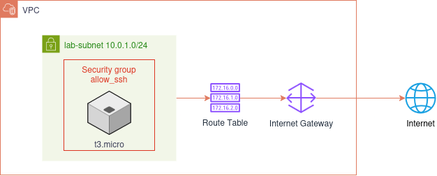

## Objetivo

Criar um ambiente de testes na AWS com uma VPC, sub-rede pública, Internet Gateway, tabela de rotas, Security Group e uma instância EC2 acessível via SSH pela internet. O objetivo é demonstrar, na prática, como os recursos de rede e computação se conectam para expor um serviço.

## Diagrama da solução

## Recursos e os seus papéis

| Recurso | Papel |
| --- | --- |
| VPC | Rede isolada onde os recursos são provisionados |
| Subrede | Um "pedaço" da vpc para provisionar as nossas instâncias |
| Internet Gateway | Serve como uma porta de entrada por onde o servidor se comunica com a internet |
| Security Group | Funciona como um firewall, permitindo tráfego de entrada somente na porta 22 e através de um ip específico |
| Par de Chaves | É composto por duas chaves, uma pública, que fica com a AWS, e uma privada, que fica com o usuário. A chave privada pode ser utilizada para acessar os servidores sem a necessidade de senhas |
| EC2 | Nossa máquina virtual gerenciada pela AWS |